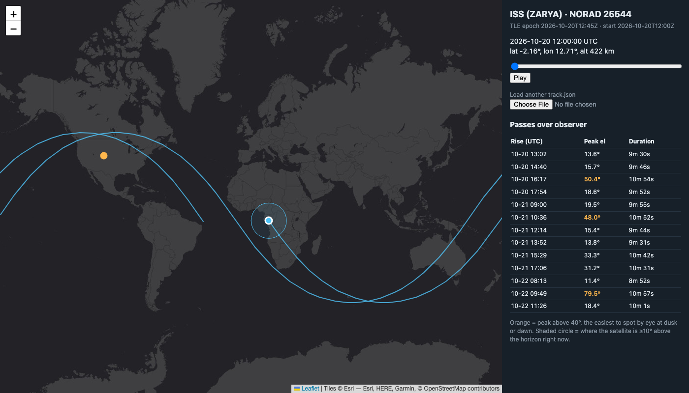

# Satellite Pass Predictor


Predicts when a satellite (the ISS by default) will be visible from a location on Earth and plots its ground track on an interactive map. It reads real orbital elements published by the U.S. Space Force through CelesTrak, propagates them with the SGP4 model, converts between coordinate frames, and searches for rise, peak, and set times.



Predictions are validated against [Skyfield](https://rhodesmill.org/skyfield/): peak times agree within 3 s and peak elevations within 0.15°.

```
$ python -m satpass passes --start 2026-10-20T12:00:00 --min-el 30
ISS (ZARYA) (NORAD 25544) passes over (40.5734, -105.0865), next 48 h, peak >= 30 deg

Rise (UTC)             Az  Peak (UTC)              El   Az  Set (UTC)              Az     Dur
2026-10-20 16:17:00   NW  2026-10-20 16:22:28  50.4  NNE  2026-10-20 16:27:54  ESE   10m53s
2026-10-21 10:36:37  WSW  2026-10-21 10:42:02  48.0  NNW  2026-10-21 10:47:29   NE   10m51s
2026-10-21 15:29:37   NW  2026-10-21 15:34:58  33.2  NNE  2026-10-21 15:40:18  ESE   10m41s
2026-10-21 17:06:29  WNW  2026-10-21 17:11:46  31.2   SW  2026-10-21 17:17:00  SSE   10m31s
2026-10-22 09:49:08   SW  2026-10-22 09:54:34  79.5   NW  2026-10-22 10:00:04   NE   10m56s
```

## Quick start

```bash
python3 -m venv .venv && source .venv/bin/activate
pip install -e ".[dev]"

satpass passes                              # ISS over Fort Collins, next 48 h (sample TLEs)
satpass passes --fetch stations             # same, with fresh TLEs from CelesTrak
satpass passes --sat 48274 --lat 39.74 --lon -104.99   # Tiangong over Denver
satpass track --fetch stations --out web/track.json    # export for the map

python -m http.server -d web 8000           # open http://localhost:8000
pytest -v
```

## How it works

```
 TLE text ──► parse + checksum ──► SGP4 ──► TEME position ──► rotate by GMST ──► ECEF
  (tle.py)                      (propagate.py)              (frames.py)            │
                                                                 ┌─────────────────┴──────────────┐
                                                                 ▼                                ▼
                                                      geodetic lat/lon/alt          observer az / el / range
                                                       (ground track, map)           (passes.py: rise/peak/set)
```

### 1. Two-Line Elements (`tle.py`)
A TLE is a fixed-width, 69-column text record that encodes an orbit's epoch, inclination, eccentricity, mean motion, drag term, and more. Column 69 holds a mod-10 checksum, and the parser rejects any record whose checksum doesn't match.

### 2. SGP4 propagation (`propagate.py`)
TLEs are not raw Keplerian elements. They are mean elements fit to the SGP4 model, so you have to propagate them with SGP4 to get correct positions. SGP4 models Earth's oblateness (J2–J4), atmospheric drag, and, for deep-space orbits, lunar and solar perturbations. This project uses the `sgp4` package, a port of Vallado's reference implementation, rather than hand-rolling it. The model is the hard part to get right, and the reference port is what operational code uses. Accuracy is about 1 km at epoch and degrades by a few km per day, which is why the CLI warns about stale TLEs.

### 3. Reference frames (`frames.py`)
SGP4 outputs positions in **TEME**, an inertial frame that does not rotate with the Earth. To know what's overhead, `frames.py`:
1. computes **Greenwich Mean Sidereal Time**, the Earth's rotation angle relative to the stars;
2. rotates TEME → **ECEF** (Earth-fixed) about the z-axis by −GMST;
3. converts ECEF → **geodetic** latitude/longitude/altitude on the WGS-84 ellipsoid, iterating because latitude has no closed-form solution on an ellipsoid;
4. for an observer, rotates the line-of-sight vector into local **East-North-Up** to get azimuth and elevation.

### 4. Pass search (`passes.py`)
Elevation as a function of time is a smooth curve that rises above 0° for roughly 10 minutes per pass. The search:

1. **Coarse scan** samples elevation every 30 s. LEO passes last several minutes, so no real pass fits between samples. A brute-force 5 s scan in the tests verifies this.
2. **Bisection** on each sign change narrows rise and set to under 1 s, which takes about 6 SGP4 calls instead of 60.
3. **Ternary search** finds the peak, since elevation is unimodal within one pass.

Total cost for 48 hours is about 6,000 propagations, which takes milliseconds.

### 5. Map (`web/index.html`)
A Leaflet map reads `track.json`. It splits the ground track at the ±180° antimeridian so the line doesn't streak across the map, animates the satellite, and draws its **visibility footprint**. The footprint is the ground radius inside which the satellite is ≥10° above the horizon, computed from the Earth-central angle λ = acos(R/(R+h)·cos e) − e.

## Design decisions

| Decision | Why |
|---|---|
| Use the reference `sgp4` library, write frames and search myself | SGP4 is a ~2,000-line model that has to match the reference exactly. Frame math and search are where the interesting engineering is, and they're small enough to test fully. |
| Ignore polar motion and UT1−UTC | Adds tens of meters of error, compared with SGP4's ~1 km. Not worth the extra data dependencies. |
| Coarse scan + bisection instead of a fixed 1 s step | ~10× fewer propagations with the same precision. |
| Validate against Skyfield | An independent oracle catches frame-convention bugs that self-consistency tests miss. |
| Commit a sample TLE file | Tests are deterministic and run offline. Live data comes from `--fetch`. |

## Testing

`pytest` runs 19 tests covering:
- TLE checksum, parsing, and epoch decoding
- GMST at J2000 against the published value
- geodetic ↔ ECEF round trips, including near the pole and at GEO altitude
- known look-angle geometry (zenith; due east)
- ISS altitude and latitude bounds over an orbit
- pass times and elevations against Skyfield
- rise and set at 0° elevation
- the peak being a true local maximum
- no pass missed, checked with a brute-force scan

## Roadmap
- [ ] Visibility: flag passes where the satellite is sunlit and the observer is in darkness, which is when you can actually see it
- [ ] Doppler shift for amateur radio contacts (range-rate from the velocity vector)
- [ ] Multi-satellite scheduling for a ground station (which pass to track when passes overlap)
- [ ] 3D globe view with CesiumJS
- [ ] Rewrite the propagation loop in C++ and benchmark it against Python

## License
MIT
